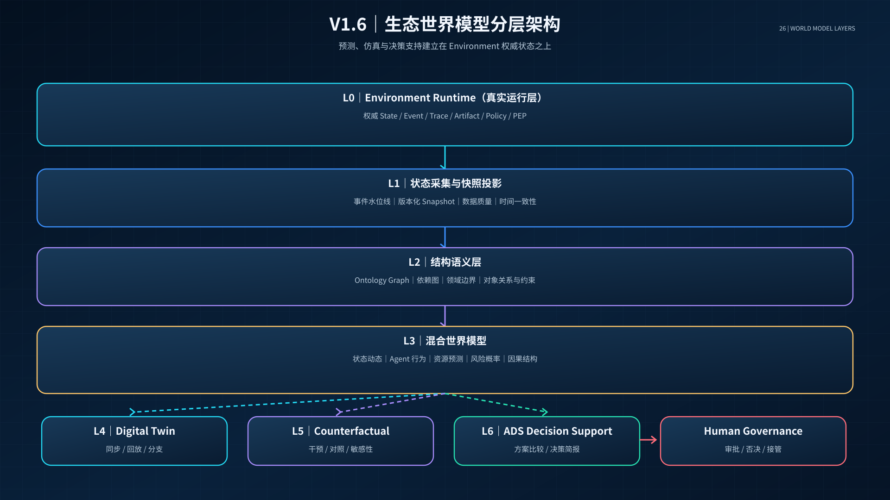
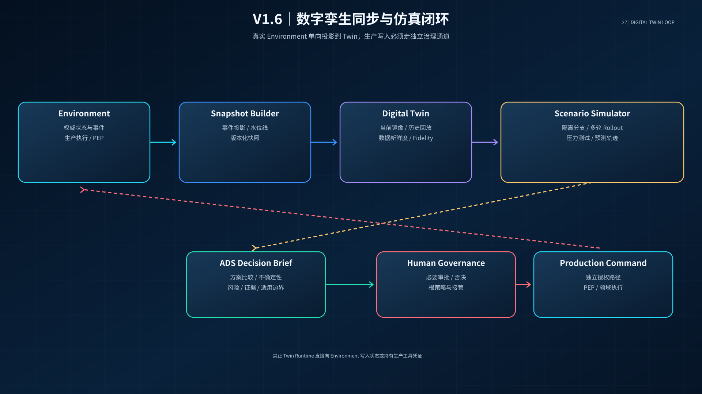
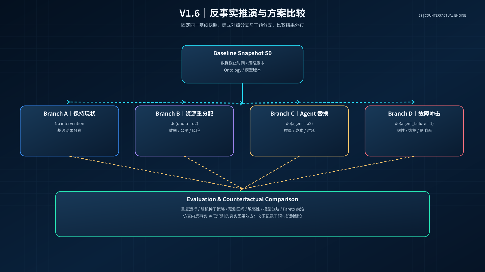
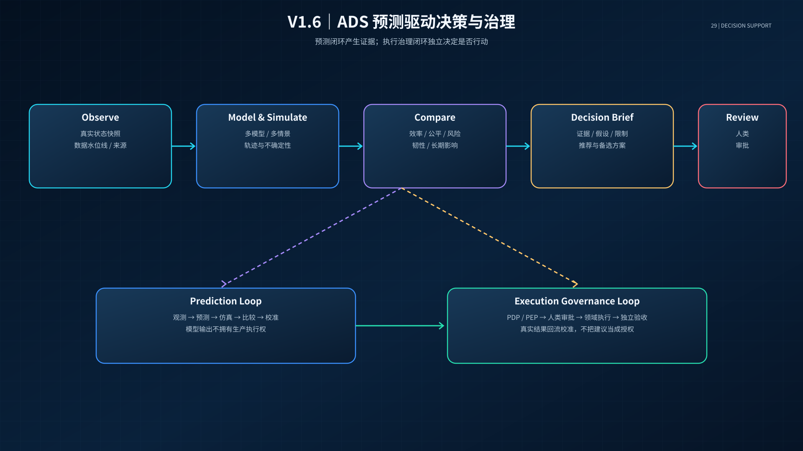
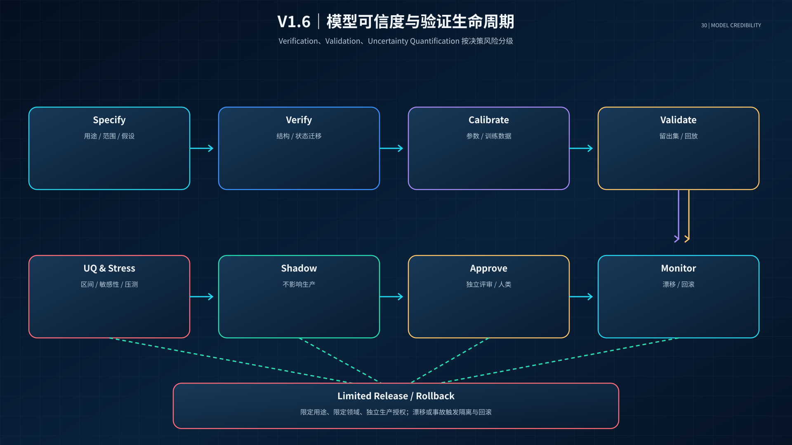
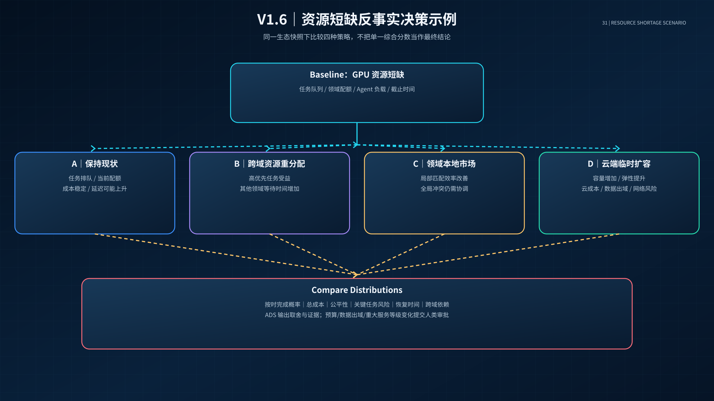

# Agent Ecology V1.6
## 生态世界模型与群体智能数字孪生架构
**版本：V1.6 架构设计版｜日期：2026年11月10日｜范围：架构研究、模型设计、仿真契约、治理与验证；不编写工程实现代码**

> V1.6 承接 V1.4 Environment Runtime 与 V1.5 Ecosystem Autonomy，新增生态认知、预测、数字孪生和反事实推演能力。世界模型是预测性模型，不是真实状态权威；数字孪生是受验证约束的镜像和实验环境，不是生产执行控制器。本卷提出架构方案和验证计划，不代表已部署或生产验证。

---

# 执行摘要

V1.6 的核心命题是：**让 Agent Ecology 不仅能够运行、自治和自我修复，还能够建立对自身的结构化理解，预测不同决策可能带来的状态变化，并在真正执行之前进行受控模拟、反事实比较和风险评估。**

V1.4 建立 Environment Runtime，解决共享状态、事件、痕迹、任务执行与权限治理；V1.5 建立生态自治机制，解决资源分配、能力信誉、动态授权、知识进化和自组织修复；V1.6 在两者之上建立 Ecosystem Intelligence，使 ADS 能够理解生态状态、模拟候选行动、评估不确定性、比较不同未来，并向人类提供有证据的决策建议。

V1.6 的关键架构边界：
- **Environment 是真实运行状态的权威来源。**
- **World Model 是预测性模型，产生的是预测状态而非事实状态。**
- **Digital Twin 是与真实生态同步的受控镜像和实验环境。**
- **Simulation Engine 负责执行可复现的情景实验。**
- **Causal/Counterfactual Engine 负责比较干预前后的可能结果，但必须声明因果假设。**
- **ADS Decision Support 负责比较方案和治理决策，不因模型预测而自动获得生产执行权。**
- **人类治理外环保留根策略审批、重大风险决策、否决权、接管权和最终问责权。**

V1.6 建议建设六个核心引擎：
1. 生态状态与结构模型；
2. 生态世界模型；
3. 数字孪生同步与仿真引擎；
4. 反事实与因果推演引擎；
5. 群体演化预测引擎；
6. 模型可信度、治理与决策支持引擎。

它们是逻辑责任边界，不要求直接拆成六个微服务。应先复用 V1.4 的 State/Event/Trace/Artifact/Policy 基础设施，采用模块化单体或领域模块方式验证，再依据负载、隔离和所有权需求渐进拆分。

---

# 79. V1.6 目标、范围与基本定义

## 79.1 目标

- 建立 Agent、Task、Capability、Resource、Domain、Policy、Knowledge 和 Artifact 的统一生态状态表示。
- 将 Environment 事件流转化为可版本化、可回放、可查询的生态状态快照。
- 建立多时间尺度的状态预测和行为模型。
- 建立数字孪生，使历史重放、当前镜像、未来情景和压力测试在同一实验框架中运行。
- 支持 What-if、Remove、Replace、Delay、Scale、Policy-change 等反事实干预。
- 对每个预测输出不确定性、适用范围、数据新鲜度、模型版本和已知盲区。
- 让 ADS 能够比较方案、解释取舍并提出 RSI 改进候选。
- 建立风险分级的模型验证、Shadow、审批、灰度、回滚和事故处理机制。

## 79.2 关键概念必须分开

| 概念 | 主要回答 | 典型输出 | 是否权威状态 |
|---|---|---|---|
| Environment | 真实生态现在是什么状态？ | State、Event、Trace、Artifact | 是 |
| World Model | 在给定行动和条件下，未来可能如何变化？ | Predicted State、Trajectory、Distribution | 否 |
| Simulator | 如何执行可重复的状态演化实验？ | Simulation Run、Rollout、Metrics | 否 |
| Digital Twin | 虚拟模型与真实生态如何持续映射和校准？ | Twin Snapshot、Sync Status、Fidelity | 否 |
| Causal Model | 某项干预可能导致什么差异？ | Intervention Effect、Counterfactual | 否 |
| Decision Support | 多个可行方案如何比较？ | Option Ranking、Trade-off、Decision Brief | 否 |
| Policy/PEP | 某个真实动作是否被允许？ | Permit/Deny/Obligations | 是，负责授权判定 |

**特别注意：世界模型、数字孪生、仿真器和因果模型不是同义词。** 一个数字孪生可以调用多个预测模型和仿真器；世界模型可以在没有完整数字孪生的情况下运行；因果模型也可能只覆盖生态的一部分关系。

## 79.3 非目标

- 不建立一个包含所有 Agent 私有上下文的全知模型。
- 不把 LLM 生成的合理叙述当成预测证据。
- 不让数字孪生直接向生产 Environment 写入状态。
- 不以一次仿真结果证明因果关系或未来必然性。
- 不用单一模型取代领域知识、规则引擎和人类判断。
- 不允许模型自行修改生产策略、扩大权限或签发 Mandate。
- 不把仿真中的成功率直接当成生产 SLA。
- 不在没有数据授权的情况下复制个人或领域敏感数据。
- 不要求所有领域共享同一个行为模型、参数或仿真保真度。

---

# 80. V1.6 总体架构：Ecosystem Intelligence Layer

## 80.1 七层架构

| 层级 | 组件 | 责任 |
|---|---|---|
| L0 真实运行层 | Environment Runtime | 权威状态、事件、任务、权限、执行 |
| L1 状态采集层 | Snapshot Builder / Event Projector | 事件投影、快照版本、数据质量 |
| L2 结构语义层 | Ontology Graph / Dependency Graph | 对象、关系、约束、所有权 |
| L3 模型层 | Dynamics / Behavior / Resource / Risk Models | 状态变化、Agent 行为、资源和风险预测 |
| L4 仿真层 | Digital Twin / Scenario Engine / Replay | 历史回放、分支模拟、压力测试 |
| L5 推演层 | Causal / Counterfactual / Sensitivity | 干预比较、因果假设、敏感性 |
| L6 决策治理层 | ADS Decision Support / PDP / Human Review | 方案比较、风险治理、审批和发布 |

## 80.2 数据与控制平面分离

- **数据平面**：Environment 状态、事件、Trace、Artifact、模型输入和仿真输出。
- **模型平面**：模型版本、参数、训练数据摘要、校准记录和适用范围。
- **实验平面**：Scenario、Intervention、Simulation Run、Replay 和 Evaluation。
- **治理平面**：策略版本、授权、审批、风险分级、模型发布和回滚。

模型平面和实验平面不得直接更改数据平面的权威状态。治理平面通过 PDP/PEP 对生产动作做独立判断。

## 80.3 世界模型的四个建模层

1. **Structural Model**：描述生态对象、关系、约束和所有权。
2. **Dynamics Model**：描述事件和行动如何改变状态。
3. **Predictive/Causal Model**：预测未来状态并评估干预差异。
4. **Decision Model**：在硬约束内比较候选方案和多目标权衡。

四层之间必须显式传递版本、数据来源、时间戳和不确定性。

---

# 81. 生态状态模型：从共享上下文到可预测状态

## 81.1 状态本体

建议将 V1.6 的生态状态表示为带版本的图结构：

\[
G_t=(V_t,E_t,A_t,\Omega_t)
\]

其中：
- \(V_t\)：Agent、Task、Resource、Capability、Domain、Policy、Knowledge、Artifact 等节点；
- \(E_t\)：协作、依赖、委托、资源占用、知识引用、信任和所有权关系；
- \(A_t\)：对象属性、状态、计量和时间字段；
- \(\Omega_t\)：Ontology 版本、策略版本、数据来源和适用边界。

## 81.2 状态分区

| 状态域 | 核心状态 | 更新来源 |
|---|---|---|
| Agent State | 身份、健康、能力版本、负载、自治模式 | Runtime、Evidence、Policy |
| Task State | 目标、阶段、依赖、验收、租约、预算 | Task Registry、State Coordinator |
| Resource State | 容量、配额、预留、消耗、拥塞 | Resource Ledger、Metrics |
| Collaboration State | 联盟、角色、痕迹、交接、阻塞 | Environment Event/Trace |
| Trust State | 能力证据、信誉、验证者独立性 | Evidence/Reputation Ledger |
| Governance State | Mandate、策略版本、撤权、审批 | ADS PDP、Domain PEP |
| Knowledge State | 知识候选、验证状态、版本、适用范围 | Knowledge Registry |
| System State | 延迟、错误率、网络分区、队列、故障 | Observability/Runtime |

## 81.3 权威数据与预测数据分区

权威数据只来自 Environment 和各领域被授权的源系统。预测数据必须独立存储：
- `observed_state`：观测到的真实状态；
- `inferred_state`：由观测推断的隐状态；
- `predicted_state`：模型预测状态；
- `counterfactual_state`：干预条件下的反事实状态；
- `simulated_state`：仿真运行内部状态。

任何 API、UI 和 Artifact 都必须明确标识这些状态类型，不能把预测值显示成实时事实。

## 81.4 时间与一致性

- 每条事件记录 `event_time`、`ingest_time`、`source_version` 和 `sequence/offset`。
- Snapshot 记录 `snapshot_id`、`cutoff_offset`、`ontology_version`、`policy_version`。
- 跨域快照应记录每个域的水位线和同步延迟。
- 事件迟到、乱序、重复、撤销和更正必须保留来源及处理方式。
- 对于无法形成一致快照的跨域状态，应标记 `PARTIAL`，不能伪装为全局一致状态。
- 对模型回放必须能确定当时实际可见的信息，避免未来数据泄漏。

---

# 82. 世界模型：结构、动态、行为、资源和风险

## 82.1 混合模型，而不是单一 LLM

| 模型 | 主要输入 | 预测对象 | 建议技术路线 |
|---|---|---|---|
| 结构模型 | Ontology、关系、约束 | 对象和依赖结构 | 图数据库/图投影、规则 |
| 状态转移模型 | 当前状态、事件、动作 | 下一状态和状态轨迹 | 状态机、统计模型、序列模型 |
| Agent 行为模型 | 角色、能力、负载、上下文 | 参与、协作、延迟、失败行为 | 规则、行为克隆、LLM 代理、混合策略 |
| 资源模型 | 任务、预算、资源池、负载 | 成本、拥塞、完成时间 | 排队论、优化、回归/概率模型 |
| 风险模型 | 行为、权限、异常、依赖 | 违规、故障传播和损失分布 | 规则、风险图、概率模型 |
| 生态演化模型 | 长期任务和交互轨迹 | 集中度、能力成长、知识扩散 | Agent-Based Model、系统动力学 |

## 82.2 状态转移

\[
\hat S_{t+1}=f_{\theta}(S_t,A_t,E_t,C_t)
\]

- \(S_t\)：版本化生态状态；
- \(A_t\)：候选动作或干预；
- \(E_t\)：外部事件和环境条件；
- \(C_t\)：约束、策略、资源和领域上下文；
- \(\theta\)：模型版本及参数；
- \(\hat S_{t+1}\)：预测状态。

模型输出应包括预测分布或区间，而非只给一个点估计。

## 82.3 多时间尺度模型

| 时间尺度 | 预测目标 | 典型使用者 |
|---|---|---|
| 秒—分钟 | Agent 心跳、队列、资源突增、短时失败 | Runtime / Domain |
| 分钟—小时 | 任务完成时间、联盟稳定性、资源冲突 | Domain Allocator |
| 天—周 | 能力变化、知识复用、领域负载 | ADS |
| 周—月 | 生态集中度、结构性脆弱、长期演化 | ADS / Human Governance |

不同时间尺度采用不同模型和刷新频率。长期模型不应伪装成实时运行监控。

## 82.4 预测不确定性

每次预测至少包含：
- 点估计（如适用）；
- 预测区间/分布；
- 置信或可信度说明；
- 数据新鲜度；
- 模型版本；
- 训练/校准适用域；
- 主要敏感变量；
- 未建模因素；
- 是否存在分布漂移。

不得用“模型信心 95%”替代统计校准，也不得把语言模型的自我置信表述当成概率证据。

## 82.5 规划器利用模型漏洞

当规划器只追求模型给出的高分时，可能找到模型错误而非真实可行的策略。必须采用：
- 独立规则约束；
- 多模型交叉检查；
- 不确定性惩罚或鲁棒优化；
- 分布外检测；
- 对极端高收益方案做红队反例测试；
- 真实环境小规模 Shadow 验证；
- 模型与规划器版本绑定。

---

# 83. 生态数字孪生：同步、回放、分支与实验

## 83.1 数字孪生不是一个 3D 看板

对 Agent Ecology 而言，数字孪生的核心是状态、行为、关系、约束和演化规则的可计算映射，而不是必须具有三维视觉界面。

数字孪生由以下对象构成：
- 真实生态状态快照；
- 事件历史和可回放轨迹；
- 生态 Ontology 和关系图；
- 行为/资源/风险模型；
- 情景库和干预定义；
- 仿真执行器；
- 模型校准和验证记录；
- 与真实生态的同步健康指标。

## 83.2 四种运行模式

1. **Historical Replay**：按时间顺序重放真实事件，验证模型能否解释过去。
2. **Current Twin**：以最新可用快照形成当前生态镜像，展示数据新鲜度和缺口。
3. **Future Simulation**：在隔离分支中模拟候选动作的未来轨迹。
4. **Stress/Adversarial Simulation**：注入故障、延迟、资源短缺、恶意行为和网络分区，评估韧性。

## 83.3 双向同步的边界

- 真实 Environment → Twin：允许通过授权事件投影和快照同步。
- Twin → Environment：默认禁止直接写入。
- Twin 的建议 → ADS：以 Decision Brief 形式提交。
- ADS → Environment：只有经过独立策略授权和必要的人类审批，才可形成正式生产命令。
- 生产命令 → Twin：回写真实执行结果，用于校准模型，但必须标记观测事实。

## 83.4 同步健康度

- Snapshot Lag；
- Event Lag；
- Missing Event Rate；
- Schema Compatibility；
- Ontology Drift；
- State Reconciliation Error；
- Source Coverage；
- Data Freshness；
- Cross-Domain Watermark Skew。

超过阈值时，Twin 状态从 `SYNCED` 降级为 `STALE` 或 `PARTIAL`，禁止给出高风险决策建议。

---

# 84. 情景模拟与反事实推演引擎

## 84.1 标准推演流程

1. 选择基线快照 `S0`，固定数据截止时间和版本。
2. 选择目标问题和结果变量。
3. 定义干预 `do(A=a)`，说明改变什么、保持什么。
4. 建立对照分支和一个或多个干预分支。
5. 在相同随机种子策略和资源条件下运行重复模拟。
6. 计算轨迹分布、结果差异和不确定性。
7. 进行敏感性、反事实和压力测试。
8. 由独立 Evaluator 检查模型适用性和反例。
9. 生成 Decision Brief，记录结论边界。
10. 若需要生产执行，另行进入 ADS/人类审批流程。

## 84.2 支持的干预类型

| 干预 | 示例 | 关注结果 |
|---|---|---|
| Remove | 移除一个 Agent | 单点依赖和韧性 |
| Replace | 用不同能力/成本 Agent 替换 | 质量、成本和时延差异 |
| Delay | 延迟某个子任务或事件 | 依赖传播和 SLA |
| Scale | 增加/减少 Agent 或资源 | 扩展性和边际收益 |
| Rewire | 改变任务依赖/协作关系 | 协作效率和故障传播 |
| Policy Change | 改变配额、公平规则或自治门槛 | 效率、公平和风险权衡 |
| Shock | 注入网络分区、模型服务故障或需求突增 | 系统韧性 |
| Knowledge Change | 采用/撤回某项知识版本 | 质量改善与回归风险 |

## 84.3 反事实与因果识别的边界

仿真器能运行 `What-if`，不意味着已经识别真实世界的因果效应。必须区分：
- **模型内反事实**：在当前模型假设下，改变一个输入得到的结果；
- **经验因果估计**：通过实验或准实验数据估计干预效应；
- **结构因果推断**：依赖明确因果图、结构方程和识别假设；
- **情景敏感性**：展示在参数变化下结果如何变化。

所有因果结论必须声明识别假设、混杂因素、干预定义、外推边界和证据来源。

## 84.4 比较方案的结果维度

- Outcome Quality；
- Completion Time；
- Resource Cost；
- Fairness；
- Failure Probability；
- Blast Radius；
- Recovery Time；
- Knowledge Gain；
- Autonomy/Policy Violation Risk；
- Long-term Concentration and Dependency。

方案比较应展示 Pareto 前沿和关键取舍，不用一个总分掩盖安全与公平的差异。

---

# 85. 群体演化预测引擎

## 85.1 长期演化问题

V1.5 关注生态内资源分配和信誉，V1.6 进一步研究这些机制长期运行后可能产生什么系统效应：
- 高信誉 Agent 是否形成垄断？
- 新 Agent 是否失去进入生态的机会？
- 领域之间是否形成过度依赖？
- 某类知识是否快速扩散并放大错误？
- 任务市场是否诱导 Agent 追逐容易计分的工作？
- 自修复机制是否导致自动重试风暴？
- ADS 公共能力是否造成领域能力趋同和单点脆弱？
- RSI 是否使系统朝局部指标而非真实目标演化？

## 85.2 生态演化模型

建议采用 Agent-Based Model 与系统动力学混合：
- 微观层：Agent 的能力、策略、资源、参与和协作行为；
- 中观层：联盟、领域市场、知识传播、依赖网络；
- 宏观层：生态效率、公平、韧性、集中度和长期风险。

## 85.3 关键预测指标

- Agent/Capability Concentration；
- Resource Herfindahl-Hirschman Index；
- Task Opportunity Gini；
- Cross-Domain Dependency Centrality；
- Knowledge Propagation Rate；
- Knowledge Reversal Rate；
- Agent Entry/Exit Rate；
- Coalition Stability；
- Recovery Cascade Probability；
- Model/Policy Drift；
- Ecosystem Resilience under Shock。

指标必须按领域、任务类型、风险等级和时间窗口分层解释。

---

# 86. ADS 决策支持：从预测到受治理的决策

## 86.1 ADS 新增职责

- 维护跨域生态状态投影和数据新鲜度；
- 选择适合问题的模型和仿真保真度；
- 创建情景、干预和反事实实验；
- 对预测结果进行不确定性和敏感性评估；
- 比较方案在效率、公平、安全和韧性上的差异；
- 生成可追溯的 Decision Brief；
- 监控真实结果与预测结果的偏差；
- 触发模型漂移审查和 RSI 候选改进。

ADS 不应：
- 将预测结果直接写入真实状态；
- 让仿真代理获得真实工具凭证；
- 将模型分数当成生产授权；
- 因预测结果而绕过领域验收；
- 自动发布新的世界模型或根策略。

## 86.2 Decision Brief 标准结构

每份决策简报必须包括：
1. 决策问题；
2. 真实状态快照和数据截止时间；
3. 基线方案；
4. 候选方案和干预定义；
5. 使用的模型、版本和参数；
6. 预测区间与不确定性；
7. 敏感性和模型分歧；
8. 安全、公平和韧性影响；
9. 适用范围、限制和反例；
10. 推荐选项及其理由；
11. 必须的人类审批项；
12. 生产执行后的观测与回滚计划。

## 86.3 预测与执行双闭环

- 预测闭环：观测 → 状态快照 → 模型预测 → 仿真 → 比较 → 校准。
- 执行治理闭环：决策建议 → PDP/PEP → 人类审批（如需要）→ 生产执行 → 独立验收。

两个闭环共享证据，但生产授权不能由预测闭环发放。

---

# 87. 模型可信度、验证与不确定性量化

## 87.1 模型生命周期

`PROPOSED → SPECIFIED → VERIFIED → CALIBRATED → VALIDATED → SHADOW → APPROVED → LIMITED_RELEASE → MONITORED`

发生漂移、数据变化、模型行为异常或事故时进入 `QUARANTINED`，必要时 `ROLLED_BACK`。

## 87.2 三类验证

- **Verification（实现正确性）**：模型是否按规格实现，状态迁移、约束和事件处理是否正确。
- **Validation（适用性）**：模型是否足以回答特定决策问题，预测与真实数据是否在可接受范围内。
- **Uncertainty Quantification（不确定性量化）**：输入、参数、结构、观测和模型选择的不确定性如何传播到输出。

不能把单一测试通过率称为“模型可信度”。

## 87.3 评价指标

| 目标 | 指标 |
|---|---|
| 状态预测 | Accuracy、F1、MAE/RMSE、结构一致性 |
| 概率预测 | Brier Score、Log Loss、Calibration Error |
| 预测区间 | Coverage、Interval Width、CRPS（适用时） |
| 轨迹预测 | Horizon-wise Error、Trajectory Consistency |
| 反事实 | Action Sensitivity、Branch Consistency、Known-Intervention Test |
| 仿真有效性 | Micro/Macro Pattern Fit、Out-of-Sample Performance |
| 因果分析 | Identification Assumptions、Placebo/Negative Controls |
| 数字孪生 | Snapshot Lag、Reconciliation Error、Source Coverage |
| 决策价值 | Regret、Utility Gain、Robustness、Human Override Rate |

MAPE 在接近零的目标值或比例尺度不稳定时不应机械使用。不同指标必须与具体预测任务和基线对应。

## 87.4 多层验证协议

1. **Specification Review**：明确模型用途、对象、边界和假设。
2. **Structural Verification**：检查 Ontology、关系和状态迁移规则。
3. **Historical Replay**：回放历史事件，检查轨迹一致性。
4. **Calibration**：使用训练/校准数据估计参数。
5. **Held-out Validation**：在未参与校准的数据上验证。
6. **Stress Testing**：注入极端事件和结构性变化。
7. **Sensitivity Analysis**：识别对结果最敏感的变量。
8. **Uncertainty Propagation**：将输入和参数不确定性传递到预测结果。
9. **Shadow Evaluation**：只生成预测，不影响生产动作。
10. **Human Review**：按风险级别审批模型适用范围。
11. **Limited Release**：在有限领域和低风险决策中试用。
12. **Continuous Monitoring**：持续检查漂移、偏差和模型失效。

## 87.5 模型可信度按用途分级

- **M0 观察型**：只描述历史或当前数据，不预测生产结果。
- **M1 探索型**：用于假设生成和研究，不参与决策排序。
- **M2 决策辅助型**：通过历史回放和留出集验证，可辅助低风险决策。
- **M3 受限决策型**：经过 Shadow、压力测试和独立评估，可支持指定领域的有限决策。
- **M4 高影响决策支持型**：需要更高强度 VVUQ、独立审查和人类审批；仍不自动拥有执行权。

M 级别是模型的适用等级，不是 Agent 自治等级，也不等同于法规认证。

---

# 88. 安全、隐私与模型攻击面

| 风险 | 可能影响 | 控制 |
|---|---|---|
| Twin-to-Production Write | 仿真误操作真实系统 | 默认隔离、独立生产 API、显式审批 |
| Data Leakage | 私有上下文进入跨域模型 | 最小投影、脱敏、联邦统计、用途限制 |
| Model Poisoning | 错误事件/数据污染模型 | 来源签名、数据质量门、版本追溯 |
| Model Extraction | 模型或敏感参数泄露 | 访问控制、速率限制、输出审计 |
| Planner Exploitation | 规划器利用模型漏洞 | 不确定性约束、独立规则、红队测试 |
| Scenario Manipulation | 操作者选择有偏情景 | 情景登记、基线固定、审计与复核 |
| Counterfactual Misuse | 将模型内反事实误说成因果事实 | 强制标注识别假设和证据等级 |
| Model Drift | 预测逐渐失准 | 漂移监测、隔离、重新校准 |
| Future Leakage | 训练/回放使用未来信息 | Snapshot Cutoff、时间一致性检查 |
| Simulation-to-Reality Gap | 仿真有效但现实失效 | 分层验证、Shadow、有限试点 |

数字孪生默认使用只读生产数据投影。任何生产写操作必须通过独立生产命令路径，不能由 Twin Runtime 直接完成。

---

# 89. V1.6 机器可读数据契约

## 89.1 核心对象

| 对象 | 关键字段 | 权威边界 |
|---|---|---|
| EcosystemSnapshot | snapshot_id、cutoff、domain_watermarks、ontology_version、policy_version、source_refs | Snapshot Builder |
| ModelSpec | model_id、version、purpose、scope、assumptions、limitations、owner | Model Registry |
| ModelArtifact | artifact_id、model_id、version、hash、training_data_ref、signature | Model Registry |
| TwinInstance | twin_id、source_domains、snapshot_ref、sync_status、fidelity_profile | Twin Registry |
| Scenario | scenario_id、baseline_snapshot、interventions、horizon、seed_policy | Scenario Registry |
| Intervention | intervention_id、target、operator、value、scope、assumptions | Scenario Registry |
| SimulationRun | run_id、scenario_id、model_versions、status、runtime、seed_refs | Simulation Engine |
| PredictedTrajectory | trajectory_id、run_id、time_steps、state_type、distribution_ref | Simulation Store |
| CounterfactualResult | result_id、baseline_ref、treatment_ref、effect_estimate、assumptions、uncertainty | Causal Engine |
| ModelEvaluation | evaluation_id、model_version、dataset_ref、metrics、limitations、reviewer | Evaluation Registry |
| DriftAlert | alert_id、model_id、signal、severity、window、recommended_action | Model Monitor |
| DecisionBrief | brief_id、decision_question、options、evidence_refs、approval_requirements | ADS Decision Support |

## 89.2 事件目录

- `ecosystem.snapshot.created.v1`
- `ecosystem.snapshot.partial.v1`
- `twin.sync.completed.v1`
- `twin.sync.degraded.v1`
- `model.spec.registered.v1`
- `model.version.proposed.v1`
- `model.evaluation.completed.v1`
- `model.shadow.started.v1`
- `model.shadow.completed.v1`
- `model.drift.detected.v1`
- `scenario.created.v1`
- `simulation.run.started.v1`
- `simulation.run.completed.v1`
- `simulation.run.failed.v1`
- `counterfactual.result.generated.v1`
- `decision.brief.created.v1`
- `decision.brief.reviewed.v1`
- `model.release.approved.v1`
- `model.release.rolled_back.v1`

## 89.3 API 家族（概念契约）

- `POST /v1/ecosystem/snapshots`
- `GET /v1/ecosystem/snapshots/{snapshot_id}`
- `POST /v1/models`
- `GET /v1/models/{model_id}/versions`
- `POST /v1/twins`
- `GET /v1/twins/{twin_id}/sync-status`
- `POST /v1/scenarios`
- `POST /v1/simulations`
- `GET /v1/simulations/{run_id}`
- `POST /v1/counterfactuals`
- `POST /v1/models/{model_id}/evaluations`
- `POST /v1/models/{model_id}/shadow`
- `POST /v1/decision-briefs`
- `POST /v1/models/{model_id}/release-requests`

以上均为架构级 API 设计，不表示已有服务或代码实现。

---

# 90. 端到端示例：ADS 在资源短缺时如何选择生态策略

## 90.1 场景

多个领域同时需要 GPU 和高能力 Agent 资源，出现跨域资源竞争。ADS 需要决定是否：
- A：保持当前配额；
- B：将一部分共享资源转给高优先级任务；
- C：启用领域本地资源市场；
- D：降低非关键任务并发；
- E：调用云端临时资源。

## 90.2 基线快照

Snapshot Builder 从各领域授权投影构建快照：
- 当前 Agent 在线和负载；
- Task 队列、优先级和截止时间；
- GPU/CPU/内存配额和实际消耗；
- 当前 Allocation Plan 和联盟依赖；
- 任务质量、成本、时延历史；
- 风险等级、授权边界和不可中断任务。

快照不包含未授权的领域私有上下文。

## 90.3 反事实实验

对 A–E 五种策略建立独立分支，每种策略在相同基线条件下运行多轮仿真，改变需求突增、Agent 失联、云资源延迟和任务失败率等因素。

输出：
- 任务按时完成概率分布；
- 资源利用率与成本分布；
- 领域公平性；
- 关键任务风险；
- 恢复时间；
- 对某个领域的依赖集中度；
- 对输入参数变化的敏感性。

## 90.4 决策

ADS 不只给出“方案 B 得分最高”，而是说明：
- B 对高优先级任务有利，但会增加其他领域延迟；
- C 改善局部效率，但跨域冲突仍需 ADS 配额协调；
- D 降低系统拥塞，但可能延误非关键业务；
- E 提高容量，但带来云成本、网络延迟和数据出域风险。

最终由 ADS 形成 Decision Brief；如涉及预算、跨域数据或重大服务等级变化，提交人类审批。生产动作由既有 Policy/PEP 和领域 Runtime 执行，Twin 本身不写入真实状态。

---

# 91. V1.6 验证计划与验收门槛

## 91.1 四阶段路线

**阶段 A：结构模型与历史回放**
- 固定 Ontology、事件 Schema 和快照定义；
- 选择一个领域历史数据；
- 重放事件，检查状态重建一致性；
- 验证时间水位线和未来数据泄漏防护。

**阶段 B：离线数字孪生**
- 建立规则、统计和 Agent 行为混合模型；
- 对过去已知任务做回测；
- 测试不同时间尺度预测；
- 输出置信区间、模型适用范围和失败案例。

**阶段 C：反事实与压力测试**
- 建立资源短缺、Agent 失联、网络分区、模型故障、知识污染等场景；
- 比较基线与干预分支；
- 进行敏感性和不确定性传播；
- 独立评估因果假设和外推限制。

**阶段 D：Shadow 决策支持**
- ADS 生成预测和方案排序，但不改变生产动作；
- 对比预测与真实执行结果；
- 评估模型增益、风险、偏差和人类审批负担；
- 只有通过评审后才考虑有限低风险试点。

## 91.2 必测用例

1. Snapshot Builder 是否准确重建给定 offset 的历史状态？
2. 跨域事件迟到和乱序时，是否正确标记 PARTIAL？
3. 回放是否意外读取 cutoff 之后的数据？
4. 模型能否预测任务时延分布，而非仅给单一 ETA？
5. 长时间 rollout 是否出现误差累积和不合理状态？
6. 规划器是否能利用模型漏洞获得虚假高收益？
7. 同一 Scenario 重复运行是否可复现？
8. 改变干预变量是否导致方向合理的预测变化？
9. 反事实结果是否明确标记为模型内结果而非已识别因果效应？
10. 不同模型对同一情景结论冲突时，是否暴露分歧？
11. 数据漂移时，Twin 是否降级并停止高风险建议？
12. Twin 是否无法绕过生产 API 直接写入 Environment？
13. 高风险 Decision Brief 是否要求人类审批？
14. 模型回滚后是否恢复旧版本并保留实验记录？

## 91.3 硬性验收门槛

- Twin 直接写入生产 Environment：0；
- 预测状态伪装成权威状态：0；
- 未记录数据截止时间的仿真：0；
- 未标注模型版本的预测：0；
- 未来数据泄漏：0；
- 高风险建议缺少不确定性和限制说明：0；
- 未经审批的模型生产发布：0；
- 通过仿真结果自动扩大 Agent 权限：0；
- 因果结论无识别假设和证据来源：0；
- 无法追溯的模型输出：0。

性能阈值必须在明确领域、任务和基线后制定，不能预设一个通用预测准确率来代表生态模型可信。

---

# 92. V1.6 架构决策记录（ADR）

| ADR | 决策 | 状态 |
|---|---|---|
| ADR-71 | Environment 是真实生态唯一权威状态源 | 强制约束 |
| ADR-72 | World Model 只产生预测状态，不直接写生产状态 | 强制约束 |
| ADR-73 | 数字孪生采用事件投影、版本化快照和隔离分支 | 候选确认 |
| ADR-74 | 世界模型采用规则、图、概率、行为和因果混合建模 | 候选确认 |
| ADR-75 | 预测必须携带模型版本、数据截止时间和不确定性 | 强制约束 |
| ADR-76 | 反事实模拟必须声明干预定义和因果假设 | 强制约束 |
| ADR-77 | 高风险决策采用风险相称的 VVUQ 和人类审批 | 强制约束 |
| ADR-78 | Twin 默认只读，生产写入通过独立命令路径 | 强制约束 |
| ADR-79 | 先单领域历史回放，再跨领域 Shadow | 候选确认 |
| ADR-80 | 不同领域可以采用不同保真度和行为模型 | 原则确认 |
| ADR-81 | 模型发布必须经过评估、Shadow、审批、灰度和回滚 | 强制约束 |
| ADR-82 | RSI 可以提出模型改进候选，不能自批生产发布 | 强制约束 |

## 92.1 待验证假设

- H1：事件驱动的版本化快照可以在跨域条件下重建足够一致的生态状态。
- H2：混合模型比单一 LLM 行为预测更稳定、成本更可控。
- H3：显式不确定性和模型分歧能够降低 ADS 过度自信决策。
- H4：基于历史回放和 Shadow 的持续校准能够降低长期预测偏差。
- H5：多分支反事实仿真能够发现静态规则和单次预测无法暴露的系统性风险。
- H6：按用途分级的 VVUQ 能在成本与可信度之间取得合理平衡。
- H7：领域本地孪生与 ADS 跨域投影能够在不集中私有数据的情况下支持生态级推演。
- H8：预测驱动的 RSI 能提升生态改进质量，但不会削弱人类外环治理。

---

# 93. V1.7 研究路线：生态级递归进化

V1.6 建立预测与推演能力后，V1.7 建议进入生态级 RSI：
1. 从运行偏差中发现系统问题；
2. 生成架构、策略、能力或资源优化候选；
3. 在数字孪生中做反事实验证；
4. 由独立评估者验证结果；
5. 在 Shadow 中观察预测增益；
6. 由人类审批生产发布；
7. 在有限范围灰度；
8. 持续监控并可回滚。

V1.7 的重点不是让 ADS 自己修改自己，而是让 ADS 能够**以证据驱动的方式提出改进、预测改进后果、验证改进价值，并在治理授权下逐步采用改进**。

---

# 附录 A：研究证据与一手资料

## A.1 2026 年近期研究

1. Kirchner, Purschke & Knoll, *A survey of world models for physical AI with uncertainty representation and control*, Discover Artificial Intelligence, 2026-09-03.  
   原始链接：https://link.springer.com/article/10.1007/s44163-026-02122-1  
   价值：状态抽象、动态、不确定性、结构先验、观测模态和决策耦合；指出误差累积、规划器利用模型漏洞、长时预测和不确定性校准问题。  
   适用边界：研究对象主要是 Physical AI，本文借鉴其世界模型设计与可信度方法，不直接外推其物理控制结论。

2. *World Reasoning Arena*, arXiv:2603.25887, 2026-03-26.  
   原始链接：https://arxiv.org/abs/2603.25887  
   价值：提出动作模拟保真度、长时预测、模拟推理与规划三类评估维度。  
   适用边界：基准任务并不等于 Agent Ecology 的直接验证集。

3. *AgentWorld: Benchmarking Long-Horizon Collaboration of Multi-agent LLMs*, arXiv:2609.31590, 2026-09-25.  
   原始链接：https://arxiv.org/abs/2609.31590  
   价值：100 个任务、长达 25–55 轮、3–20 个异构 Agent；提出 Causal Collaboration Effectiveness，显示多 Agent 长程协作仍有显著失效。  
   适用边界：MMORPG 沙箱不能代表所有企业 Agent 工作流，但可参考其因果贡献评估和长程测试方法。

4. *Long-Horizon Textual World Modeling through Structured Reasoning*, arXiv:2610.06637, 2026-10-05.  
   原始链接：https://arxiv.org/abs/2610.06637  
   价值：使用显式文本状态和稀疏状态变化描述多步演化，研究长时误差累积和反事实敏感性。  
   适用边界：在 ScienceWorld、Jericho 和 CEO-Bench 等环境测试，不等同于开放式多 Agent 生态部署。

5. *FutureSim: Replaying World Events to Evaluate Adaptive Agents*, arXiv:2605.15188, 2026-05-14.  
   原始链接：https://arxiv.org/abs/2605.15188  
   价值：以真实事件时间顺序构建长期适应性预测评测；报告最佳 Agent 预测准确率 25%，不少 Agent 的 Brier Skill Score 不优于常数基线。  
   适用边界：该基准研究的是开放世界事件预测，不能直接推断所有结构化生态模型的表现；其结果提醒我们不能高估长期预测能力。

6. Piao et al., *AgentSociety: Large-scale simulation of LLM-driven generative agents advances understanding of human behaviors and society*, iFuture, 2026. DOI: 10.26599/IF.2026.9710004.  
   原始链接：https://doi.org/10.26599/IF.2026.9710004  
   价值：报告超过 10,000 个生成式 Agent 和约 500 万次交互的社会仿真。  
   适用边界：期刊页面标记为 Just Accepted，页面同时显示评审状态字段；应将其视为早期规模化研究证据，而非广泛独立复现的成熟生产平台。

7. Srinivasan, NIST AMS 100-85, *On Methods of Uncertainty Quantification in Computational Modeling and Simulation: Harmonizing Modeling and Metrology Practices*, 2026-10-05.  
   原始链接：https://doi.org/10.6028/NIST.AMS.100-85  
   价值：提出按模型影响和决策后果进行风险相称的 VVUQ 与不确定性评估。  
   适用边界：主要面向计算建模和仿真可信度，本文借鉴其风险分级和 UQ 思路。

## A.2 关键基础研究

8. *A Conceptual Framework for Digital Twins of Multi-Agent Systems*, Procedia Computer Science, 2025, Vol. 257, pp.321–328. DOI: 10.1016/j.procs.2025.03.043.  
   原始链接：https://doi.org/10.1016/j.procs.2025.03.043  
   价值：将数据驱动 Agent-Based Modeling and Simulation 与数字孪生结合，支持实时数据校准和 What-if 场景探索。  
   适用边界：概念框架和说明性案例，不是跨领域生产验证。

9. *Integrating Counterfactual Simulations with Language Models for Explaining Multi-Agent Behaviour*, AAMAS 2026, pp.956–966. DOI: 10.65109/MCSD1905.  
   原始链接：https://doi.org/10.65109/MCSD1905  
   价值：使用模拟器执行 What-if/Remove 反事实询问，支持多 Agent 决策解释。  
   适用边界：实验围绕自动驾驶场景，需在 Agent Ecology 的任务和资源场景重新验证。

10. *How to keep it adequate: A protocol for ensuring validity in agent-based simulation*, Environmental Modelling & Software, 2023, 159, 105559. DOI: 10.1016/j.envsoft.2022.105559.  
    原始链接：https://doi.org/10.1016/j.envsoft.2022.105559  
    价值：提出情境适配的 Agent-Based Simulation 有效性论证与 12 步协议，强调模型构建、推断、校准、仿真和不确定性需整体验证。  
    适用边界：方法论框架，具体验证指标仍需按 Agent Ecology 决策问题定制。

11. *Generative Agents: Interactive Simulacra of Human Behavior*, UIST 2023. DOI: 10.1145/3586183.3606763.  
    原始链接：https://doi.org/10.1145/3586183.3606763  
    价值：观察、计划、记忆和反思可产生一定程度的涌现式社会行为。  
    适用边界：25 个 Agent 的研究演示，不代表大规模企业生态的预测准确性。

## A.3 证据等级

- E1：同行评审研究、公开基准和系统综述；
- E2：官方机构发布的技术报告或设计建议；
- E3：基于研究证据提出的 V1.6 架构推导；
- E4：必须通过 Agent Ecology 历史回放、仿真、Shadow 或受控试点验证的假设。

---

# 附录 B：与 V1.4/V1.5 的版本关系

| 既有能力 | V1.6 扩展 |
|---|---|
| V1.4 Environment State | 版本化生态快照和状态投影 |
| V1.4 Event/Trace Ledger | 历史回放、训练/校准证据和时间一致性 |
| V1.4 Ontology | 生态结构模型和关系图 |
| V1.4 Policy/PEP | Twin 隔离、模型用途约束和生产审批 |
| V1.5 Resource Market | 资源预测、拥塞模拟和反事实配额 |
| V1.5 Capability/Reputation | 能力演化预测和信誉漂移分析 |
| V1.5 Dynamic Autonomy | 自治策略变化的模拟与风险评估 |
| V1.5 Knowledge Evolution | 知识传播、污染扩散和回滚影响预测 |
| V1.5 Self-Repair | 故障传播、联盟重组和恢复策略仿真 |
| V1.5 ADS Governance | 生态预测、Decision Brief 和受治理 RSI |

---

# 附录 C：版本结论

**V1.6 已形成生态状态模型、世界模型分层、数字孪生同步、情景模拟、反事实与因果推演、群体演化预测、ADS 决策支持、模型可信度与 VVUQ、安全边界、数据契约和验证路线的架构设计。**

当前状态为架构设计版。建议先选择一个领域建立事件快照和历史回放基线，再验证资源分配与 Agent 故障两个情景，随后进入 Shadow 决策支持。未通过验证之前，不应把预测模型用于自动生产决策。
